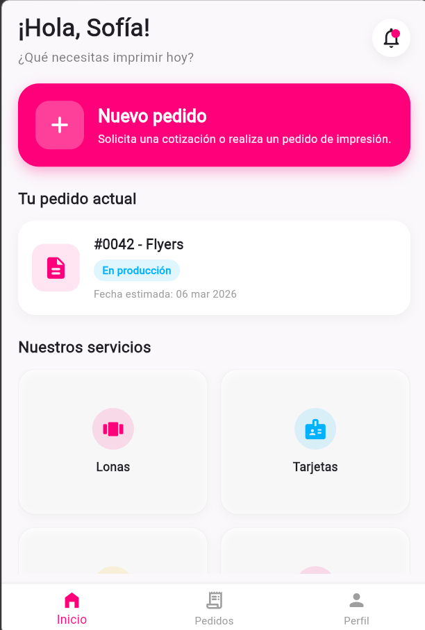
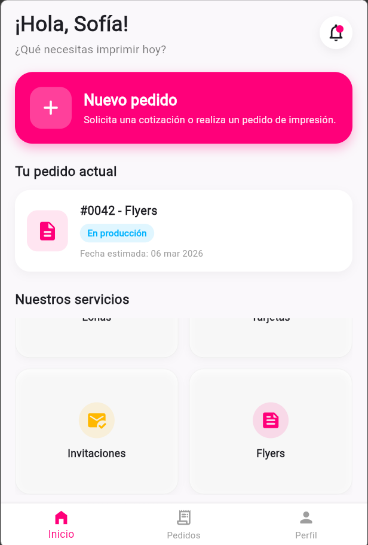

# 🖨️ InPrint - Tu idea, en tus manos

> Aplicación móvil desarrollada en **Flutter** para la gestión, cotización y realización de pedidos de impresión digital y offset.

---

## 📱 Capturas de Pantalla

| Pantalla Principal | Detalle de Producto / Modal |
| :---: | :---: |



---

## ✨ Características Principales

- 👤 **Interfaz Personalizada:** Saludo dinámico y experiencia de usuario adaptada.
- 🎨 **Diseño Corporativo:** Paleta de colores alineada a la identidad visual de la marca InPrint.
- 🛍️ **Catálogo Interactivo:** Tarjetas de servicios (Lonas, Tarjetas de presentación, Invitaciones, Flyers) con modales interactivos para ver detalles y cotizar.
- 📦 **Seguimiento de Pedidos:** Visualización del estado actual de producción de tus pedidos.
- 🧩 **Arquitectura Limpia:** Estructura de código modular, limpia y mantenible en Flutter.

---

## 🛠️ Tecnologías Utilizadas

- **Lenguaje:** Dart 🎯
- **Framework:** Flutter 💙
- **Patrón de Arquitectura:** Componentes reutilizables / Modulares

---

## 📁 Estructura del Proyecto

```text
lib/
├── constants/       # Colores corporativos y constantes globales (AppColors)
├── models/          # Modelos de datos (ProductModel)
├── widgets/         # Widgets modulares y reutilizables
└── screens/         # Pantallas principales (HomeScreen)